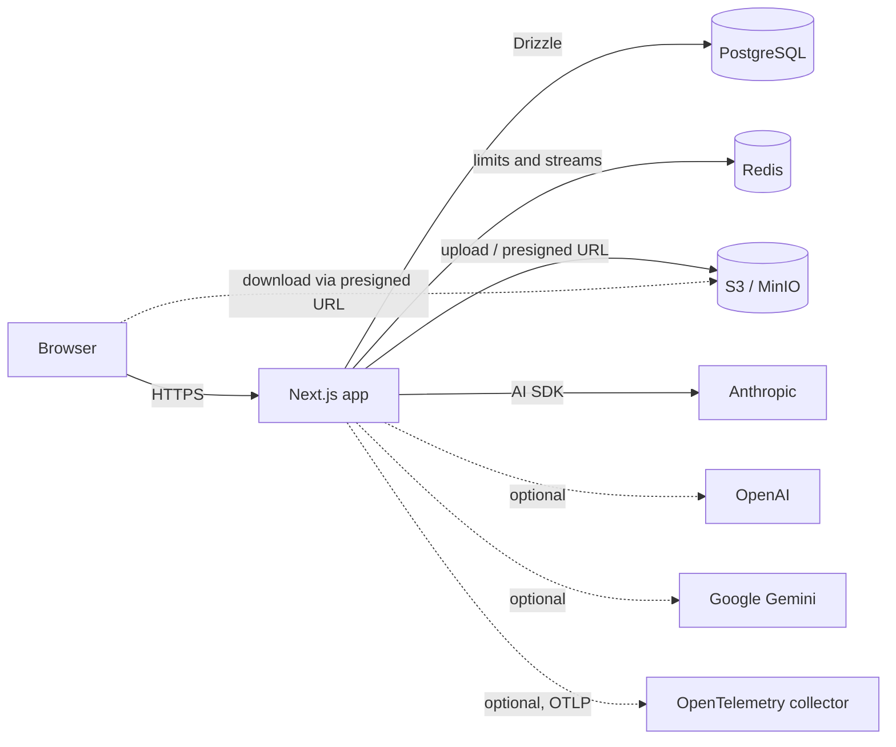

<p align="center">
  
</p>

<p align="center">
  <strong>AI assistant for renal nursing</strong><br>
  English · <a href="README.md">Español</a>
</p>

---

NefroIA is a conversational AI assistant for nursing staff in nephrology and hemodialysis units: it computes dialysis indicators with verified formulas, answers citing the unit's own protocols and turns session notes into a structured record, with clinical-safety and privacy guardrails.

> NefroIA is a **decision-support** tool: it does not diagnose or prescribe, and it does not replace clinical judgment, unit protocols or medical orders. Do not enter patient-identifying data. The protocols in `docs/protocolos-demo/` are demo documents, not for clinical use.

## Clinical features

- **Hemodialysis calculators as AI tools**: URR, spKt/V (Daugirdas 2nd generation), interdialytic weight gain, ultrafiltration rate and fluid balance. Pure, unit-tested functions with zod validation and translated errors, rendered in an accessible card with value, band (color + text label), formula, substitution, reference (KDOQI 2015, Daugirdas 1993, Flythe 2011) and disclaimer.
- **Unit protocols (RAG)**: `/protocolos` page to upload PDF, Word, Markdown or text; extraction, cleaning, section-aware chunking with page metadata, local (`multilingual-e5-small`) or OpenAI embeddings and hybrid search (pgvector/HNSW or `real[]` + Spanish full-text search) fused with Reciprocal Rank Fusion. The assistant cites `[document, page/section]` with chips that open the source chunk and answers "I don't know" when not grounded. Each user only sees their own documents.
- **Session record**: the nurse's free-text notes become a structured record (initials, machine, dialyzer, access, weights, BP/HR, UF, heparin, events) via structured output; missing fields stay empty and are listed, and numbers not present in the notes are discarded. Indicators and alerts are computed automatically. `/hojas` page with CSV export and printable view.
- **Guardrails**: redaction of personal data (Colombian ID numbers, phones, emails, names, dates of birth, medical record numbers) before anything is stored or sent to the model, with a user notice; red-flag detection with immediate escalation advice; decision-support system prompt; persistent disclaimer in es/en.

Design decisions, formulas with references, limitations and the threat model are in [`docs/arquitectura-clinica.md`](docs/arquitectura-clinica.md) (Spanish).

## Platform features

- Streaming chat, per-user history and private/public chats.
- Spanish (default) and English UI with a visible, cookie-persisted language switcher. The model replies in the user's language.
- Direct AI providers: Anthropic (default), plus OpenAI and Google, enabled only when their API key is set.
- File attachments (images and PDF, max 5 MB) in a private S3 bucket, validated by real file signature and served via presigned URLs.
- Documents and artifacts (text, code, spreadsheets, images) generated by the assistant.
- Sign-up, sign-in and guest mode, with login rate limiting and a configurable per-user message limit.
- Resumable streams with Redis, optional OpenTelemetry tracing.
- Light/dark theme using the brand palette.

## Stack

Next.js 16 (App Router) · React 19 · AI SDK · next-intl · Auth.js · Drizzle ORM + PostgreSQL 16 (optional pgvector) · Transformers.js (local embeddings) · Redis 7 · S3 (MinIO locally) · Tailwind CSS 4 + shadcn/ui · Vitest · Playwright · Biome (Ultracite).

## Architecture



### Message flow: guardrails, tools and RAG

```mermaid
flowchart TB
  M[Nurse message] --> RD[PII redaction]
  RD --> RF[Red-flag detection]
  RF -->|notice + escalation alert| UI[UI]
  RF -->|redacted text + decision-support prompt| LLM[Language model]
  LLM -->|tool call| CALC[Calculators<br/>URR · spKt/V · IDWG · UFR · balance]
  LLM -->|tool call| RAG[buscarProtocolos]
  LLM -->|tool call| HS[crearHojaSesion]
  RAG --> V[Vector<br/>pgvector HNSW or real&#91;&#93;]
  RAG --> L[Lexical<br/>Spanish tsvector]
  V --> RRF[Reciprocal Rank Fusion<br/>+ relevance threshold]
  L --> RRF
  RRF -->|chunks P1..Pn| LLM
  HS -->|zod structured output| VER[Number grounding check<br/>+ calculations + alerts]
  VER --> DB[(session_record)]
  CALC --> UI
  RRF --> UI
  VER --> UI
  LLM -->|answer with citations| UI
```



## Local setup with Docker

Requirements: Docker with Compose v2.

```bash
cp .env.example .env
# Edit .env: set ANTHROPIC_API_KEY and AUTH_SECRET (openssl rand -base64 32)
docker compose up --build
```

The app is served at http://localhost:3000. Compose starts the app, PostgreSQL 16, Redis 7 and MinIO (console at http://localhost:9001), creates the private bucket and applies migrations before starting the app.

### Running the app without Docker

Requirements: Node.js 22 (`.nvmrc`) and pnpm.

```bash
docker compose up -d postgres redis minio minio-init   # supporting services
cp .env.example .env.local                              # and fill in the values
pnpm install
pnpm db:migrate
pnpm db:seed                                            # demo user and data
pnpm dev
```

### Demo data

`pnpm db:seed` creates (or recreates) the user **demo@nefroia.app** / **NefroIA-demo-2026** (configurable with `DEMO_USER_EMAIL` and `DEMO_USER_PASSWORD`) with the three original demo protocols in `docs/protocolos-demo/` (intradialytic hypotension, vascular access care and pre/post blood sampling) and two fictitious session records. Sign in at `/login` and open `/protocolos` and `/hojas`. Without access to huggingface.co, run the seed and the app with `EMBEDDING_PROVIDER=hash`.

## Environment variables

All of them are documented in [`.env.example`](.env.example). The main ones:

| Variable | Required | Description |
| --- | --- | --- |
| `AUTH_SECRET` | Yes | Session secret (`openssl rand -base64 32`). |
| `POSTGRES_URL` | Yes | PostgreSQL connection string. |
| `ANTHROPIC_API_KEY` | Yes | Default AI provider. |
| `OPENAI_API_KEY`, `GOOGLE_GENERATIVE_AI_API_KEY` | No | Enable OpenAI / Google models. |
| `REDIS_URL` | No | Resumable streams and rate limits shared across instances. |
| `S3_BUCKET`, `S3_ENDPOINT`, `S3_PUBLIC_ENDPOINT`, `S3_ACCESS_KEY_ID`, `S3_SECRET_ACCESS_KEY` | No* | File storage (*uploads are disabled without it). |
| `RATE_LIMIT_*`, `AUTH_RATE_LIMIT_*` | No | Message and sign-in attempt limits. |
| `OTEL_EXPORTER_OTLP_ENDPOINT` | No | Enables trace export. |
| `EMBEDDING_PROVIDER` | No | `local` (e5, default), `openai` or `hash` (tests, offline). |
| `EMBEDDING_CACHE_DIR` | No | Local embedding model cache. |
| `DEMO_USER_EMAIL`, `DEMO_USER_PASSWORD` | No | Credentials of the `pnpm db:seed` user. |

## Scripts

| Command | Description |
| --- | --- |
| `pnpm dev` | Development server. |
| `pnpm build` / `pnpm start` | Production build and run. |
| `pnpm check` / `pnpm fix` | Lint and format (Ultracite/Biome). |
| `pnpm typecheck` | `tsc --noEmit`. |
| `pnpm test:unit` | Unit tests (Vitest). |
| `pnpm test:integration` | RAG ingestion + retrieval on real migrations (PGlite + pgvector and, with `INTEGRATION_POSTGRES_URL`, a disposable PostgreSQL). |
| `pnpm test:e2e` | End-to-end tests (Playwright, mock models). |
| `pnpm db:generate` / `pnpm db:migrate` | Generate and apply Drizzle migrations. |
| `pnpm db:seed` | Demo user, protocols and session records. |

## Deployment

The `Dockerfile` image is multi-stage, uses Next.js `standalone` output and runs as a non-root user, with a healthcheck on `/ping`.

1. Build the image: `docker build -t nefroia .`
2. Apply migrations before each deployment using the `migrate` target: `docker build --target migrate -t nefroia-migrate . && docker run --rm -e POSTGRES_URL=... nefroia-migrate`.
3. Run the app with the environment variables above, a managed PostgreSQL, Redis and a **private** S3 bucket.
4. Serve the app behind HTTPS and set `AUTH_URL` and `NEXT_PUBLIC_APP_URL` to the public URL.

Continuous integration (`.github/workflows/ci.yml`) runs lint, type checking, unit tests, build and e2e tests against a service PostgreSQL, with no production secrets.

## License

Distributed under the Apache License 2.0. See [LICENSE](LICENSE) and [NOTICE](NOTICE).
