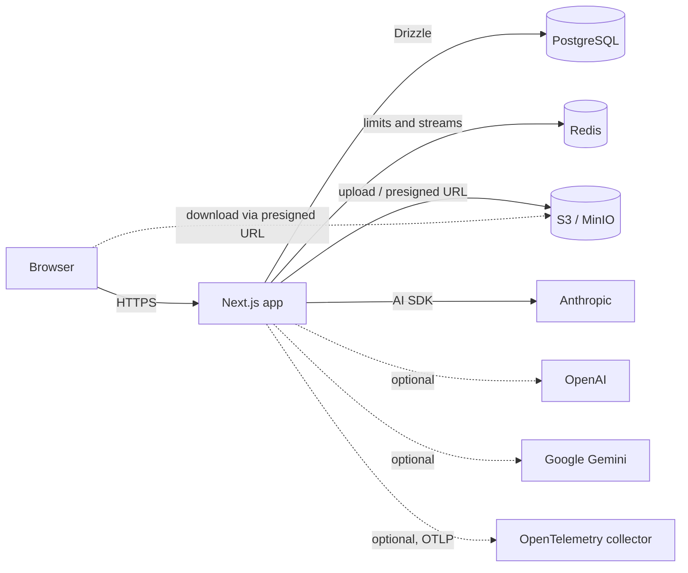

<p align="center">
  
</p>

<p align="center">
  <strong>AI assistant for renal nursing</strong><br>
  English · <a href="README.md">Español</a>
</p>

---

NefroIA is a conversational AI assistant for nursing staff in nephrology and hemodialysis units. This first version provides the technical foundation (authentication, streaming chat, history, file attachments, internationalization and production-ready infrastructure) on top of which the clinical features will be built.

> NefroIA is a support tool. It does not replace clinical judgment or unit protocols. Do not enter data that identifies patients.

## Features

- Streaming chat, per-user history and private/public chats.
- Spanish (default) and English UI with a visible, cookie-persisted language switcher. The model replies in the user's language.
- Direct AI providers: Anthropic (default), plus OpenAI and Google, enabled only when their API key is set.
- File attachments (images and PDF, max 5 MB) in a private S3 bucket, validated by real file signature and served via presigned URLs.
- Documents and artifacts (text, code, spreadsheets, images) generated by the assistant.
- Sign-up, sign-in and guest mode, with login rate limiting and a configurable per-user message limit.
- Resumable streams with Redis, optional OpenTelemetry tracing.
- Light/dark theme using the brand palette.

## Stack

Next.js 16 (App Router) · React 19 · AI SDK · next-intl · Auth.js · Drizzle ORM + PostgreSQL 16 · Redis 7 · S3 (MinIO locally) · Tailwind CSS 4 + shadcn/ui · Vitest · Playwright · Biome (Ultracite).

## Architecture



## Local setup with Docker

Requirements: Docker with Compose v2.

```bash
cp .env.example .env
# Edit .env: set ANTHROPIC_API_KEY and AUTH_SECRET (openssl rand -base64 32)
docker compose up --build
```

The app is served at http://localhost:3000. Compose starts the app, PostgreSQL 16, Redis 7 and MinIO (console at http://localhost:9001), creates the private bucket and applies migrations before starting the app.

### Running the app without Docker

Requirements: Node.js 22 (`.nvmrc`) and pnpm.

```bash
docker compose up -d postgres redis minio minio-init   # supporting services
cp .env.example .env.local                              # and fill in the values
pnpm install
pnpm db:migrate
pnpm dev
```

## Environment variables

All of them are documented in [`.env.example`](.env.example). The main ones:

| Variable | Required | Description |
| --- | --- | --- |
| `AUTH_SECRET` | Yes | Session secret (`openssl rand -base64 32`). |
| `POSTGRES_URL` | Yes | PostgreSQL connection string. |
| `ANTHROPIC_API_KEY` | Yes | Default AI provider. |
| `OPENAI_API_KEY`, `GOOGLE_GENERATIVE_AI_API_KEY` | No | Enable OpenAI / Google models. |
| `REDIS_URL` | No | Resumable streams and rate limits shared across instances. |
| `S3_BUCKET`, `S3_ENDPOINT`, `S3_PUBLIC_ENDPOINT`, `S3_ACCESS_KEY_ID`, `S3_SECRET_ACCESS_KEY` | No* | File storage (*uploads are disabled without it). |
| `RATE_LIMIT_*`, `AUTH_RATE_LIMIT_*` | No | Message and sign-in attempt limits. |
| `OTEL_EXPORTER_OTLP_ENDPOINT` | No | Enables trace export. |

## Scripts

| Command | Description |
| --- | --- |
| `pnpm dev` | Development server. |
| `pnpm build` / `pnpm start` | Production build and run. |
| `pnpm check` / `pnpm fix` | Lint and format (Ultracite/Biome). |
| `pnpm typecheck` | `tsc --noEmit`. |
| `pnpm test:unit` | Unit tests (Vitest). |
| `pnpm test:e2e` | End-to-end tests (Playwright, mock models). |
| `pnpm db:generate` / `pnpm db:migrate` | Generate and apply Drizzle migrations. |

## Deployment

The `Dockerfile` image is multi-stage, uses Next.js `standalone` output and runs as a non-root user, with a healthcheck on `/ping`.

1. Build the image: `docker build -t nefroia .`
2. Apply migrations before each deployment using the `migrate` target: `docker build --target migrate -t nefroia-migrate . && docker run --rm -e POSTGRES_URL=... nefroia-migrate`.
3. Run the app with the environment variables above, a managed PostgreSQL, Redis and a **private** S3 bucket.
4. Serve the app behind HTTPS and set `AUTH_URL` and `NEXT_PUBLIC_APP_URL` to the public URL.

Continuous integration (`.github/workflows/ci.yml`) runs lint, type checking, unit tests, build and e2e tests against a service PostgreSQL, with no production secrets.

## License

Distributed under the Apache License 2.0. See [LICENSE](LICENSE) and [NOTICE](NOTICE).
