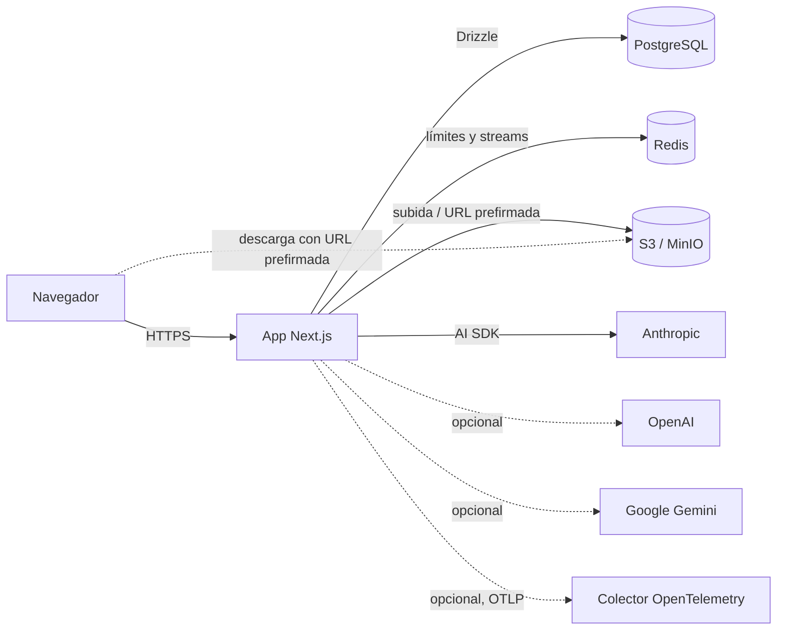

<p align="center">
  
</p>

<p align="center">
  <strong>Asistente de IA para enfermería renal</strong><br>
  <a href="README.en.md">English</a> · Español
</p>

---

NefroIA es un asistente conversacional de IA pensado para el personal de enfermería de unidades de nefrología y hemodiálisis. Esta primera versión aporta la base técnica (autenticación, chat con streaming, historial, archivos adjuntos, internacionalización e infraestructura lista para producción) sobre la que se construirán las funciones clínicas específicas.

> NefroIA es una herramienta de apoyo. No sustituye el juicio clínico ni los protocolos de la unidad. No introduzcas datos que identifiquen a pacientes.

## Características

- Chat con respuestas en streaming, historial por usuario y chats públicos/privados.
- Interfaz en español (por defecto) e inglés, con selector de idioma visible y persistido en cookie. El modelo responde en el idioma del usuario.
- Múltiples proveedores de IA directos: Anthropic (por defecto), y opcionalmente OpenAI y Google, activados solo si se configura su clave.
- Archivos adjuntos (imágenes y PDF, máx. 5 MB) en un bucket S3 privado, con validación por firma real del archivo y URLs prefirmadas.
- Documentos y artefactos (texto, código, hojas de cálculo, imágenes) generados por el asistente.
- Registro, inicio de sesión y modo invitado, con límite de intentos y límite configurable de mensajes por usuario.
- Streams reanudables con Redis, telemetría OpenTelemetry opcional.
- Tema claro/oscuro con la paleta de marca.

## Stack

Next.js 16 (App Router) · React 19 · AI SDK · next-intl · Auth.js · Drizzle ORM + PostgreSQL 16 · Redis 7 · S3 (MinIO en local) · Tailwind CSS 4 + shadcn/ui · Vitest · Playwright · Biome (Ultracite).

## Arquitectura



## Puesta en marcha local con Docker

Requisitos: Docker con Compose v2.

```bash
cp .env.example .env
# Edita .env: define ANTHROPIC_API_KEY y AUTH_SECRET (openssl rand -base64 32)
docker compose up --build
```

La aplicación queda en http://localhost:3000. Compose levanta la app, PostgreSQL 16, Redis 7 y MinIO (consola en http://localhost:9001), crea el bucket privado y aplica las migraciones antes de iniciar la app.

### Desarrollo sin Docker para la app

Requisitos: Node.js 22 (`.nvmrc`) y pnpm.

```bash
docker compose up -d postgres redis minio minio-init   # servicios de apoyo
cp .env.example .env.local                              # y completa los valores
pnpm install
pnpm db:migrate
pnpm dev
```

## Variables de entorno

Todas están documentadas en [`.env.example`](.env.example). Las principales:

| Variable | Obligatoria | Descripción |
| --- | --- | --- |
| `AUTH_SECRET` | Sí | Secreto de sesión (`openssl rand -base64 32`). |
| `POSTGRES_URL` | Sí | Conexión a PostgreSQL. |
| `ANTHROPIC_API_KEY` | Sí | Proveedor de IA por defecto. |
| `OPENAI_API_KEY`, `GOOGLE_GENERATIVE_AI_API_KEY` | No | Habilitan los modelos de OpenAI / Google. |
| `REDIS_URL` | No | Streams reanudables y límites compartidos entre instancias. |
| `S3_BUCKET`, `S3_ENDPOINT`, `S3_PUBLIC_ENDPOINT`, `S3_ACCESS_KEY_ID`, `S3_SECRET_ACCESS_KEY` | No* | Almacenamiento de archivos (*sin él, la subida se desactiva). |
| `RATE_LIMIT_*`, `AUTH_RATE_LIMIT_*` | No | Límites de mensajes y de intentos de acceso. |
| `OTEL_EXPORTER_OTLP_ENDPOINT` | No | Activa la exportación de trazas. |

## Scripts

| Comando | Descripción |
| --- | --- |
| `pnpm dev` | Servidor de desarrollo. |
| `pnpm build` / `pnpm start` | Compilación y ejecución de producción. |
| `pnpm check` / `pnpm fix` | Lint y formato (Ultracite/Biome). |
| `pnpm typecheck` | `tsc --noEmit`. |
| `pnpm test:unit` | Pruebas unitarias (Vitest). |
| `pnpm test:e2e` | Pruebas e2e (Playwright, con modelos simulados). |
| `pnpm db:generate` / `pnpm db:migrate` | Generar y aplicar migraciones de Drizzle. |

## Despliegue

La imagen del `Dockerfile` es multi-stage, usa la salida `standalone` de Next.js y se ejecuta como usuario no root, con healthcheck en `/ping`.

1. Construye la imagen: `docker build -t nefroia .`
2. Aplica las migraciones antes de cada despliegue con el target `migrate`: `docker build --target migrate -t nefroia-migrate . && docker run --rm -e POSTGRES_URL=... nefroia-migrate`.
3. Ejecuta la app con las variables de entorno anteriores, un PostgreSQL gestionado, Redis y un bucket S3 **privado**.
4. Sirve la app detrás de HTTPS y define `AUTH_URL` y `NEXT_PUBLIC_APP_URL` con la URL pública.

La integración continua (`.github/workflows/ci.yml`) ejecuta lint, tipos, pruebas unitarias, build y pruebas e2e contra un PostgreSQL de servicio, sin secretos de producción.

## Licencia

Distribuido bajo Apache License 2.0. Ver [LICENSE](LICENSE) y [NOTICE](NOTICE).
