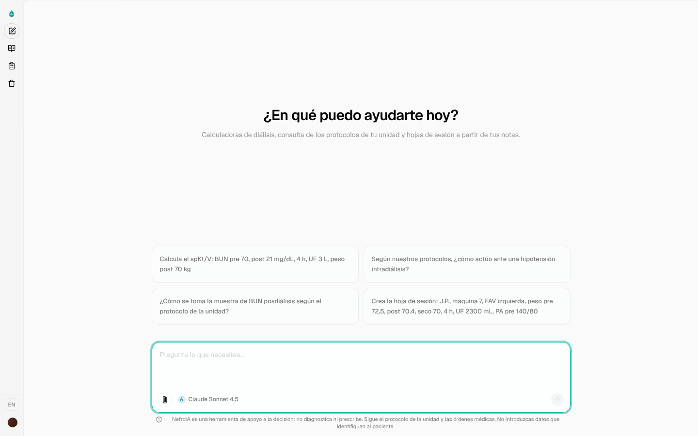
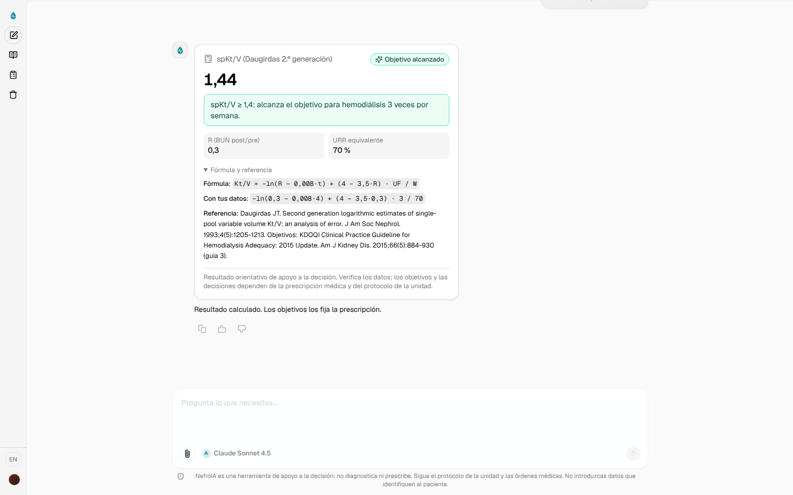
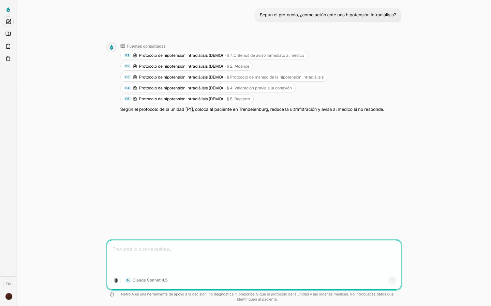
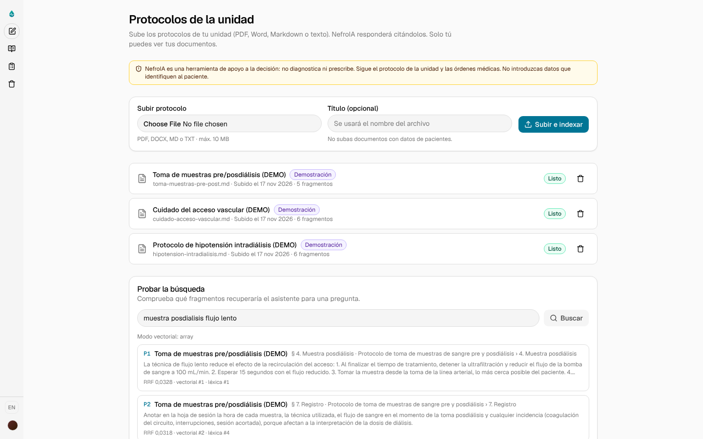
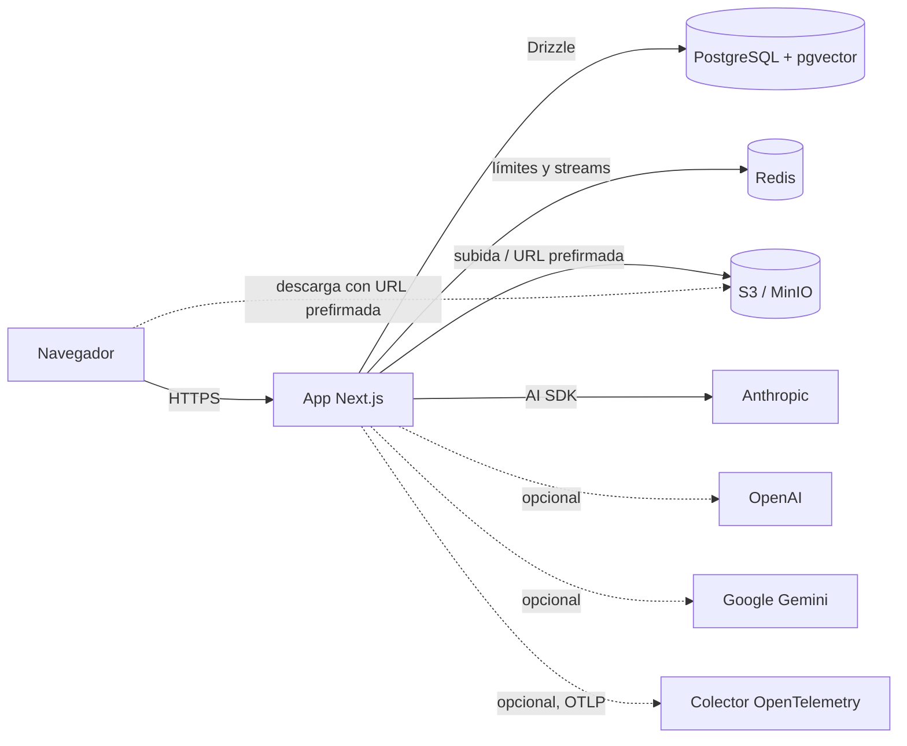
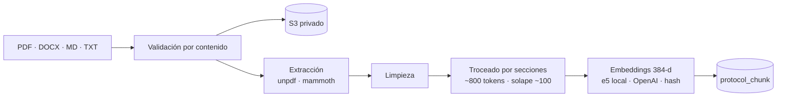

<p align="center">
  
</p>

<p align="center">
  <strong>Asistente de IA para enfermería renal</strong><br>
  <a href="README.en.md">English</a> · Español
</p>

---

NefroIA es un asistente conversacional de IA para el personal de enfermería de unidades de nefrología y hemodiálisis: calcula indicadores de diálisis con fórmulas verificadas, responde citando los protocolos de la propia unidad y convierte las notas de una sesión en una hoja estructurada, con guardarraíles de seguridad clínica y de privacidad.

> NefroIA es una herramienta de **apoyo a la decisión**: no diagnostica ni prescribe, y no sustituye el juicio clínico, los protocolos de la unidad ni la prescripción médica. No introduzcas datos que identifiquen a pacientes. Los protocolos de `docs/protocolos-demo/` son documentos de demostración, no aptos para uso clínico.

## Capturas

| Chat | Calculadora (spKt/V) |
| --- | --- |
|  |  |
| **Respuesta con citas de protocolos** | **Protocolos y probador de búsqueda** |
|  |  |

Documento técnico completo (arquitectura, base de datos, fórmulas, seguridad, despliegue): [`docs/NefroIA-Documento-Tecnico.docx`](docs/NefroIA-Documento-Tecnico.docx).

## Funciones clínicas

- **Calculadoras de hemodiálisis como herramientas de IA**: URR, spKt/V (Daugirdas 2.ª generación), ganancia de peso interdialítica, tasa de ultrafiltración y balance hídrico. Funciones puras con pruebas, validación con zod y errores traducidos, y una tarjeta accesible con valor, banda (color + texto), fórmula, sustitución, referencia (KDOQI 2015, Daugirdas 1993, Flythe 2011) y aviso.
- **Protocolos de la unidad (RAG)**: página `/protocolos` para subir PDF, Word, Markdown o texto; extracción, limpieza, troceado por secciones con página, embeddings locales (`multilingual-e5-small`) u OpenAI, y búsqueda híbrida (pgvector/HNSW o `real[]` + texto completo en español) fusionada con Reciprocal Rank Fusion. El asistente cita `[documento, página/sección]` con chips que abren el fragmento y responde "no lo sé" cuando no hay fundamento. Cada usuario solo ve sus documentos.
- **Hoja de sesión**: las notas libres de la enfermera se convierten en un registro estructurado (iniciales, máquina, dializador, acceso, pesos, PA/FC, UF, heparina, incidencias) con salida estructurada; lo que falta queda vacío y listado, y los números que no constan en las notas se descartan. Calcula indicadores y alertas automáticamente. Página `/hojas` con exportación CSV y vista imprimible.
- **Guardarraíles**: redacción de datos personales (cédula colombiana, teléfonos, correos, nombres, fechas de nacimiento, historias clínicas) antes de guardar o enviar nada al modelo, con aviso al usuario; detección de signos de alarma con alerta de escalamiento inmediato; prompt de apoyo a la decisión; aviso persistente en es/en.

Las decisiones de diseño, fórmulas con referencias, limitaciones y el análisis de amenazas están en [`docs/arquitectura-clinica.md`](docs/arquitectura-clinica.md).

## Características de la plataforma

- Chat con respuestas en streaming, historial por usuario y chats públicos/privados.
- Interfaz en español (por defecto) e inglés, con selector de idioma visible y persistido en cookie. El modelo responde en el idioma del usuario.
- Múltiples proveedores de IA directos: Anthropic (por defecto), y opcionalmente OpenAI y Google, activados solo si se configura su clave.
- Archivos adjuntos (imágenes y PDF, máx. 5 MB) en un bucket S3 privado, con validación por firma real del archivo y URLs prefirmadas.
- Documentos y artefactos (texto, código, hojas de cálculo, imágenes) generados por el asistente.
- Registro, inicio de sesión y modo invitado, con límite de intentos y límite configurable de mensajes por usuario.
- Streams reanudables con Redis, telemetría OpenTelemetry opcional.
- Tema claro/oscuro con la paleta de marca.

## Stack

Next.js 16 (App Router) · React 19 · AI SDK · next-intl · Auth.js · Drizzle ORM + PostgreSQL 16 (pgvector opcional) · Transformers.js (embeddings locales) · Redis 7 · S3 (MinIO en local) · Tailwind CSS 4 + shadcn/ui · Vitest · Playwright · Biome (Ultracite).

## Arquitectura



### Flujo de un mensaje: guardarraíles, herramientas y RAG

```mermaid
flowchart TB
  M[Mensaje de la enfermera] --> RD[Redacción de PII]
  RD --> RF[Detección de signos de alarma]
  RF -->|aviso + alerta de escalamiento| UI[Interfaz]
  RF -->|texto redactado + prompt de apoyo a la decisión| LLM[Modelo de lenguaje]
  LLM -->|tool call| CALC[Calculadoras<br/>URR · spKt/V · GID · TUF · balance]
  LLM -->|tool call| RAG[buscarProtocolos]
  LLM -->|tool call| HS[crearHojaSesion]
  RAG --> V[Vectorial<br/>pgvector HNSW o real&#91;&#93;]
  RAG --> L[Léxica<br/>tsvector español]
  V --> RRF[Reciprocal Rank Fusion<br/>+ umbral de relevancia]
  L --> RRF
  RRF -->|fragmentos P1..Pn| LLM
  HS -->|salida estructurada zod| VER[Verificación de números<br/>+ cálculos + alertas]
  VER --> DB[(session_record)]
  CALC --> UI
  RRF --> UI
  VER --> UI
  LLM -->|respuesta con citas| UI
```



### Ingesta de protocolos



## Puesta en marcha local con Docker

Requisitos: Docker con Compose v2.

```bash
cp .env.example .env
# Edita .env: define ANTHROPIC_API_KEY y AUTH_SECRET (openssl rand -base64 32)
docker compose up --build
```

La aplicación queda en http://localhost:3000. Compose levanta la app, PostgreSQL 16, Redis 7 y MinIO (consola en http://localhost:9001), crea el bucket privado y aplica las migraciones antes de iniciar la app.

### Desarrollo sin Docker para la app

Requisitos: Node.js 22 (`.nvmrc`) y pnpm.

```bash
docker compose up -d postgres redis minio minio-init   # servicios de apoyo
cp .env.example .env.local                              # y completa los valores
pnpm install
pnpm db:migrate
pnpm db:seed                                            # usuario y datos de demostración
pnpm dev
```

### Datos de demostración

`pnpm db:seed` crea (o recrea) el usuario **demo@nefroia.app** / **NefroIA-demo-2026** (configurable con `DEMO_USER_EMAIL` y `DEMO_USER_PASSWORD`) con los tres protocolos originales de `docs/protocolos-demo/` (hipotensión intradiálisis, cuidado del acceso vascular y toma de muestras pre/post) y dos hojas de sesión ficticias. Inicia sesión en `/login` y visita `/protocolos` y `/hojas`. Sin acceso a huggingface.co, ejecuta el seed y la app con `EMBEDDING_PROVIDER=hash`.

## Variables de entorno

Todas están documentadas en [`.env.example`](.env.example). Las principales:

| Variable | Obligatoria | Descripción |
| --- | --- | --- |
| `AUTH_SECRET` | Sí | Secreto de sesión (`openssl rand -base64 32`). |
| `POSTGRES_URL` | Sí | Conexión a PostgreSQL. |
| `ANTHROPIC_API_KEY` | Sí | Proveedor de IA por defecto. |
| `OPENAI_API_KEY`, `GOOGLE_GENERATIVE_AI_API_KEY` | No | Habilitan los modelos de OpenAI / Google. |
| `REDIS_URL` | No | Streams reanudables y límites compartidos entre instancias. |
| `S3_BUCKET`, `S3_ENDPOINT`, `S3_PUBLIC_ENDPOINT`, `S3_ACCESS_KEY_ID`, `S3_SECRET_ACCESS_KEY` | No* | Almacenamiento de archivos (*sin él, la subida se desactiva). |
| `RATE_LIMIT_*`, `AUTH_RATE_LIMIT_*` | No | Límites de mensajes y de intentos de acceso. |
| `OTEL_EXPORTER_OTLP_ENDPOINT` | No | Activa la exportación de trazas. |
| `EMBEDDING_PROVIDER` | No | `local` (e5, por defecto), `openai` o `hash` (pruebas, sin red). |
| `EMBEDDING_CACHE_DIR` | No | Caché del modelo de embeddings local. |
| `DEMO_USER_EMAIL`, `DEMO_USER_PASSWORD` | No | Credenciales del usuario de `pnpm db:seed`. |

## Scripts

| Comando | Descripción |
| --- | --- |
| `pnpm dev` | Servidor de desarrollo. |
| `pnpm build` / `pnpm start` | Compilación y ejecución de producción. |
| `pnpm check` / `pnpm fix` | Lint y formato (Ultracite/Biome). |
| `pnpm typecheck` | `tsc --noEmit`. |
| `pnpm test:unit` | Pruebas unitarias (Vitest). |
| `pnpm test:integration` | Ingesta + búsqueda RAG con migraciones reales (PGlite + pgvector y, con `INTEGRATION_POSTGRES_URL`, un PostgreSQL desechable). |
| `pnpm test:e2e` | Pruebas e2e (Playwright, con modelos simulados). |
| `pnpm db:generate` / `pnpm db:migrate` | Generar y aplicar migraciones de Drizzle. |
| `pnpm db:seed` | Usuario, protocolos y hojas de demostración. |

## Despliegue

La imagen del `Dockerfile` es multi-stage, usa la salida `standalone` de Next.js y se ejecuta como usuario no root, con healthcheck en `/ping`.

1. Construye la imagen: `docker build -t nefroia .`
2. Aplica las migraciones antes de cada despliegue con el target `migrate`: `docker build --target migrate -t nefroia-migrate . && docker run --rm -e POSTGRES_URL=... nefroia-migrate`.
3. Ejecuta la app con las variables de entorno anteriores, un PostgreSQL gestionado, Redis y un bucket S3 **privado**.
4. Sirve la app detrás de HTTPS y define `AUTH_URL` y `NEXT_PUBLIC_APP_URL` con la URL pública.

La integración continua (`.github/workflows/ci.yml`) ejecuta lint, tipos, pruebas unitarias, build y pruebas e2e contra un PostgreSQL de servicio, sin secretos de producción.

## Licencia

Distribuido bajo Apache License 2.0. Ver [LICENSE](LICENSE) y [NOTICE](NOTICE).
