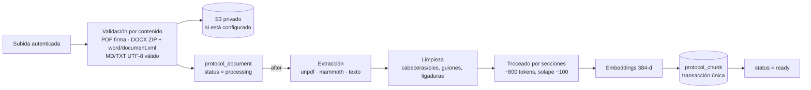

# Arquitectura clínica de NefroIA

Este documento describe y justifica las funciones clínicas de NefroIA: calculadoras de hemodiálisis, búsqueda en los protocolos de la unidad (RAG), hoja de sesión estructurada y guardarraíles de seguridad. Está pensado para revisión técnica y clínica: cada decisión indica la alternativa descartada y por qué.

> NefroIA es una herramienta de **apoyo a la decisión** para enfermería. No diagnostica, no prescribe y no sustituye el protocolo de la unidad ni la prescripción médica. Los protocolos incluidos en `docs/protocolos-demo/` son **documentos de demostración, no aptos para uso clínico**.

## 1. Principios

1. **Lo determinista fuera del modelo.** Fórmulas, umbrales, redacción de datos personales y detección de signos de alarma son funciones puras con pruebas unitarias. El modelo de lenguaje decide *cuándo* usarlas y explica el resultado, pero no hace la aritmética ni decide qué es un dato personal.
2. **Nunca inventar.** Un valor ausente se deja vacío y se dice que falta; una respuesta sin fundamento en los protocolos se responde con "no lo sé".
3. **Citar siempre.** Cada cálculo lleva su fórmula, la sustitución con los datos y la referencia bibliográfica; cada respuesta basada en protocolos cita documento y página o sección.
4. **Aislamiento por usuario.** El usuario de la sesión se toma del servidor en todas las consultas; el modelo no puede elegirlo.
5. **Defensa en profundidad.** Los avisos de seguridad se muestran en la interfaz aunque el modelo los ignore.

## 2. Vista general

```mermaid
flowchart TB
  U[Enfermera] -->|mensaje| R["/api/chat"]
  subgraph G[Guardarraíles deterministas]
    RD[Redacción de PII<br/>lib/safety/redact.ts]
    RF[Signos de alarma<br/>lib/safety/red-flags.ts]
  end
  R --> RD --> RF
  RF -->|avisos persistentes| UI[Interfaz]
  RF -->|prompt + texto redactado| LLM[Modelo de lenguaje]
  LLM -->|tool calls| T{Herramientas}
  T --> C[Calculadoras<br/>lib/clinical/*]
  T --> S[buscarProtocolos<br/>lib/rag/search.ts]
  T --> H[crearHojaSesion<br/>lib/clinical/session-record.ts]
  S --> PG[(PostgreSQL<br/>tsvector + real[] / pgvector)]
  H -->|salida estructurada zod| LLM2[Modelo] --> V[Verificación de números<br/>y cálculo de alertas] --> PG
  C --> UI
  S --> UI
  H --> UI
```

## 3. Calculadoras clínicas

Código: `lib/clinical/*.ts` (funciones puras), herramientas en `lib/ai/tools/clinical-calculators.ts`, tarjeta en `components/clinical/calculation-card.tsx`, pruebas en `tests/unit/clinical.test.ts`.

Cada calculadora devuelve `{ value, unit, band, interpretationKey, interpretationParams, formula, substitution, reference, details, disclaimerKey }`. La interfaz traduce las claves (es/en) y muestra la banda con **color + icono + texto** (nunca solo color).

### 3.1 Fórmulas, umbrales y referencias

| Calculadora | Fórmula | Bandas | Referencia |
| --- | --- | --- | --- |
| URR | (BUN_pre − BUN_post) / BUN_pre × 100 | < 65 % alerta · 65–70 % adecuado · ≥ 70 % objetivo | Owen et al., NEJM 1993; NKF-KDOQI 2006 (mínimo 65 %, objetivo 70 %). KDOQI 2015 mantiene la dosis mínima equivalente (spKt/V 1,2). |
| spKt/V (Daugirdas 2.ª gen.) | −ln(R − 0,008·t) + (4 − 3,5·R) · UF / W, con R = BUN_post/BUN_pre, t en h, UF en L, W = peso post (kg) | < 1,2 alerta · 1,2–1,4 adecuado · ≥ 1,4 objetivo (solo 3 sesiones/semana) | Daugirdas, JASN 1993;4:1205-13. KDOQI Hemodialysis Adequacy 2015 (guía 3: objetivo 1,4, mínimo entregado 1,2). |
| Ganancia interdialítica (GID) | peso_pre − peso_post_previo; % = GID / peso_seco × 100 | > 4 % alerta · ≤ 4 % adecuado · negativa: informativa | Umbral **de uso habitual**, no una recomendación graduada (KDOQI 2015 guía 4; DOPPS, Wong et al. AJKD 2017). |
| Tasa de UF | UF (mL) / (peso (kg) × h) | > 13 alerta · 10–13 precaución · ≤ 10 óptimo | Flythe et al., Kidney Int 2011; discutido en KDOQI 2015 (guía 4, minimizar la tasa de UF). |
| Balance hídrico | (oral + IV + cebado/retorno + transfusión) − (UF + diuresis + otras pérdidas) | Siempre informativo | Registro de enfermería; sin umbral normativo. |

Ejemplos resueltos (verificados a mano en las pruebas):

- URR: BUN 70 → 21 mg/dL ⇒ (70 − 21)/70 = **70 %** (objetivo).
- spKt/V: R = 0,30, t = 4 h, UF = 3 L, W = 70 kg ⇒ −ln(0,268) + 2,95·3/70 = 1,3168 + 0,1264 = **1,44** (objetivo).
- spKt/V: R = 0,35, t = 3,5 h, UF = 2 L, W = 70 kg ⇒ 1,1332 + 0,0793 = **1,21** (adecuado; coincide con la equivalencia conocida URR 65 % ≈ Kt/V 1,2).
- TUF: 4000 mL / (70 kg × 4 h) = **14,3 mL/kg/h** (alerta); 3640 mL ⇒ 13,0 (precaución: el umbral es estrictamente "> 13").

### 3.2 Decisiones

- **Validación con zod y códigos traducibles.** Cada magnitud tiene un rango de *plausibilidad* (no de normalidad) que detecta errores de unidad típicos: 240 "horas" (eran minutos), 3000 "L" de UF (eran mL), peso 0. Las incoherencias entre campos también se validan (BUN post ≥ pre; dominio del logaritmo R − 0,008·t > 0; cambio de peso entre sesiones > 15 kg). Los errores son códigos (`clinical.errors.*`) con el rango permitido, de modo que la tarjeta los muestra en el idioma de la interfaz.
- **Esquema permisivo en la herramienta.** El `inputSchema` del tool solo exige números: si el modelo envía un valor implausible, la herramienta devuelve `ok: false` con los códigos en lugar de fallar en el SDK. Así el modelo puede preguntar "¿la duración estaba en minutos?" y la enfermera ve exactamente qué campo falla.
- **La banda se decide sobre el valor redondeado** que ve la enfermera (65,0 % es "adecuado", no "alerta" por un 64,996 interno).
- **spKt/V con frecuencias distintas de 3/semana** se informa con banda "informativa": los umbrales 1,2/1,4 de KDOQI están definidos para hemodiálisis trisemanal.
- **La URR acepta mg/dL o mmol/L**: es un cociente, la unidad solo cambia el rango de plausibilidad.
- **El balance hídrico no tiene banda clínica**: un balance 0 no es "adecuado" por sí mismo; depende del objetivo de la sesión.
- **Sin aprobación del usuario**: son cálculos puros sin efectos secundarios.

## 4. Protocolos de la unidad (RAG)

Código: `lib/rag/*` (puro, base de datos inyectada), `lib/protocols/service.ts`, rutas `app/(clinical)/api/protocolos/*`, página `/protocolos`, herramienta `buscarProtocolos`.

### 4.1 Ingesta



- **Respuesta inmediata y procesamiento con `after()`**: la subida devuelve 202 y la página consulta el estado cada 2 s. La ingesta es idempotente (borra e inserta los fragmentos del documento en una transacción), de modo que una búsqueda nunca ve un documento a medias.
- **Validación por contenido real**: se reutiliza la validación por *magic bytes* de los adjuntos. DOCX se reconoce leyendo el directorio central del ZIP sin descomprimir (debe contener `[Content_Types].xml` y `word/document.xml`) y se rechaza si el tamaño descomprimido declarado supera 60 MB (defensa ante *zip bombs*). Markdown y texto no tienen firma: se exige extensión `.md/.markdown/.txt` **y** UTF-8 válido sin bytes nulos.
- **Original en S3 privado** con clave `protocols/<userId>/<documentId>.<ext>`. Si S3 no está configurado, se indexa igualmente el texto (la cita apunta al fragmento, no al archivo).
- **Limpieza**: líneas repetidas en los bordes de ≥ 60 % de las páginas (cabeceras/pies), números de página, palabras partidas con guion al final de línea, ligaduras tipográficas y caracteres de control.
- **Troceado** (`lib/rag/chunk.ts`): los encabezados (Markdown, numerados "2.1 Título" o en mayúsculas) construyen la ruta de sección "Protocolo › Actuación" que se guarda como metadato `heading`; la página de inicio se guarda en `page`. Un encabezado cierra el fragmento si ya tiene ≥ 120 tokens (secciones como unidad de cita); los bloques demasiado largos se parten por frases y, si hace falta, por palabras; el solapamiento (~100 tokens de frases completas) se aplica **solo dentro de la misma sección**.
- **Tamaño de fragmento y límite del modelo**: el objetivo es ~800 tokens con ~100 de solape, pero `multilingual-e5-small` solo admite 512 tokens; un fragmento más largo se truncaría *silenciosamente* al vectorizarlo. Por eso el tamaño efectivo es `min(800, maxInputTokens del embedder − 40)`: 800 con OpenAI o el embedder de pruebas, 440 con e5. Se estima ~4 caracteres por token (conservador para español).
- **Texto vectorizado contextualizado**: `título — sección\ncontenido`, para que un fragmento sin palabras clave herede el contexto de su sección.

### 4.2 Embeddings

Interfaz `Embedder` (`lib/rag/embeddings/types.ts`): `id`, `dimensions`, `maxInputTokens`, `minRelevantSimilarity`, `embedPassages`, `embedQuery`. Todas las implementaciones devuelven vectores de **384 dimensiones normalizados en L2** (producto escalar = coseno), por lo que el esquema no cambia al cambiar de proveedor.

| Proveedor (`EMBEDDING_PROVIDER`) | Modelo | Notas |
| --- | --- | --- |
| `local` (por defecto) | `Xenova/multilingual-e5-small` con `@huggingface/transformers` (ONNX, q8) | Sin coste ni envío de los protocolos a terceros. Prefijos obligatorios `query:` y `passage:`. Se descarga de huggingface.co la primera vez (caché en `EMBEDDING_CACHE_DIR`). |
| `openai` | `text-embedding-3-small` con `dimensions: 384` | Opcional (requiere `OPENAI_API_KEY`). Reducción Matryoshka que ofrece la API. Implica enviar el texto de los protocolos a OpenAI. |
| `hash` | *Feature hashing* FNV-1a de palabras y 4-gramas de caracteres | Determinista y sin red. **No es semántico**: solo para pruebas, CI y entornos sin acceso al modelo. Se usa por defecto con `PLAYWRIGHT=True`. |

Cada documento guarda `embeddingModel` y la búsqueda solo compara vectores del mismo modelo: cambiar de proveedor exige reindexar (los documentos de otro modelo no se mezclan ni producen similitudes sin sentido).

### 4.3 Almacenamiento y búsqueda vectorial

- **Columna canónica `embedding real[]`**: funciona en cualquier PostgreSQL.
- **pgvector opcional** (migración `0003_pgvector_opcional.sql`): si la extensión está disponible, se crea y se añade la columna **generada** `embeddingVec vector(384)` (`embedding::vector(384)`) con índice **HNSW** `vector_cosine_ops`. La migración está protegida: comprueba `pg_available_extensions` y captura la falta de permisos, emitiendo un `NOTICE` en lugar de fallar. PL/pgSQL planifica cada sentencia al ejecutarla, así que el tipo `vector` no se resuelve donde no existe.
- **Detección en tiempo de ejecución**: `hasVectorColumn()` consulta `information_schema` una vez por conexión. Con pgvector se ordena por `embeddingVec <=> consulta` (índice HNSW); sin él, por el producto escalar sobre `real[]` calculado en SQL (exacto, sin índice; suficiente para los cientos o pocos miles de fragmentos de una unidad).
- Alternativa descartada: declarar `vector(384)` en el esquema de Drizzle. Obligaría a tener pgvector en todos los entornos (desarrollo local, CI, PGlite) y rompería la migración donde no está instalado.
- `docker-compose.yml` y el CI usan `pgvector/pgvector:pg16`.

### 4.4 Recuperación híbrida

1. **Vectorial**: 20 candidatos por similitud coseno.
2. **Léxica en español**: `tsvector` generado (`to_tsvector('spanish', searchText)`, índice GIN) y `ts_rank_cd`. `searchText` se guarda en minúsculas y **sin tildes** (la consulta se normaliza igual), porque el personal escribe a menudo "hipotension" en el móvil; `unaccent` no se puede usar en una columna generada (no es `IMMUTABLE`). La consulta se construye en modo **OR** con términos saneados (`[a-z0-9]`, sin palabras vacías): `plainto_tsquery`/`websearch_to_tsquery` usan AND y son demasiado estrictas para preguntas en lenguaje natural.
3. **Fusión por Reciprocal Rank Fusion** (Cormack et al., SIGIR 2009), `k = 60`: combina posiciones, no puntuaciones, porque coseno y `ts_rank` no son comparables.
4. **Umbral de relevancia**: un candidato vectorial solo entra en la fusión si supera `minRelevantSimilarity` del modelo (e5 concentra las similitudes en 0,7–0,9; el hash, mucho más abajo). Si no queda ningún fragmento, `grounded = false` y el prompt obliga a responder "no lo sé con base en los protocolos disponibles".
5. **Aislamiento**: todas las consultas filtran por `userId` (desnormalizado en `protocol_chunk` para filtrar antes de ordenar) y por `status = 'ready'`. El fragmento citado se lee con `GET /api/protocolos/fragmentos/:id`, que responde 404 también para fragmentos ajenos (no revela su existencia).

### 4.5 Citas

`buscarProtocolos` devuelve fragmentos con referencia `P1…Pn`, título, página o sección y un extracto. El prompt exige citar `[P1]` en el texto; la interfaz muestra *chips* "P1 · Título · p. 3" (o "§ Sección" en Word/Markdown) que abren el fragmento completo en un diálogo con el aviso de verificar el documento vigente. La página `/protocolos` incluye un probador de búsqueda que muestra las posiciones vectorial y léxica y la puntuación RRF de cada resultado.

## 5. Hoja de sesión

Código: `lib/clinical/session-record.ts` (puro), `lib/session-records/*`, herramienta `crearHojaSesion`, páginas `/hojas` y `/hojas/[id]`.

1. Las notas se **redactan** (PII) antes de nada, también cuando llegan desde la página `/hojas` sin pasar por el chat.
2. **Salida estructurada** con `generateText` + `Output.object` y un esquema zod donde **todos los campos son `nullable` y obligatorios**: el modelo debe decidir explícitamente `null` en lugar de omitir o completar. Prompt: copiar solo lo escrito; convertir unidades únicamente si son explícitas.
3. **Verificación de números contra las notas** (`isGroundedNumber`): cada número propuesto debe aparecer en el texto, directamente o tras una conversión evidente (L↔mL, h↔min, "4 h 30 min" = 4,5 h). Si no aparece, se descarta y se lista en `unverifiedFields`. Es la defensa principal contra valores alucinados.
4. **Alias**: solo iniciales o seudónimo. Un nombre completo se convierte en iniciales ("Juan Pérez" → "J.P."), y se descartan cifras largas (posible documento) y marcadores de redacción.
5. `missingFields` lista los campos esperados que faltan.
6. **Cálculos automáticos** con las mismas funciones de §3: GID, TUF (con UF conseguida, o la objetivo si falta, y peso post o seco), URR y spKt/V si hay BUN, balance con la UF conseguida.
7. **Alertas**: signos de alarma en incidencias (crítico); bandas de alerta de las calculadoras; PAS nadir < 90 mmHg (Flythe et al., JASN 2015); caída de PAS ≥ 20 mmHg respecto a la previa (KDOQI 2005, que la exige con síntomas: se muestra como "atención"); FC < 50 o > 120; peso post > 1 kg sobre el peso seco; UF conseguida < 90 % del objetivo.
8. Se guarda en `session_record` (columnas tipadas para pesos, UF, BUN, duración; JSONB para controles de PA/FC, incidencias, cálculos y alertas; notas originales redactadas). `chatId` no es clave foránea: la hoja sobrevive si se borra el chat.
9. **Exportación CSV** (`/api/hojas/export`): BOM UTF-8, separador `;` y coma decimal (Excel en español), y neutralización de **inyección de fórmulas** (CWE-1236: celdas que empiezan por `= + - @` se prefijan con `'`).
10. **Vista imprimible**: CSS `@media print` (A4, sin barra lateral ni controles, línea de firma de enfermería).

## 6. Guardarraíles de seguridad

| Capa | Dónde | Qué hace |
| --- | --- | --- |
| Redacción de PII | `lib/safety/redact.ts`, aplicada en `/api/chat` **antes** de guardar el mensaje, generar el título o llamar al modelo | Cédula y otros documentos colombianos (CC, TI, CE, RC, NUIP, pasaporte, con o sin puntos), números con forma de cédula, móviles y fijos colombianos, correos, nombres tras palabras clave ("paciente", "Sr.", "nombre:"...), fechas de nacimiento y números de historia clínica. Sustituye por marcadores (`[NOMBRE]`, `[DOCUMENTO]`...). No toca valores clínicos (pesos, UI de heparina, BUN, "500 cc"). |
| Aviso de redacción | Parte `data-redaction` del mensaje del asistente | "Se ocultaron N datos personales (tipos) antes de enviar el mensaje al modelo". Persistente. |
| Signos de alarma | `lib/safety/red-flags.ts` | Expresiones de paro, dolor torácico, pérdida de conciencia, disnea grave, hipotensión grave/refractaria, sangrado o salida de aguja, embolia gaseosa, anafilaxia, convulsiones, hemólisis e hiperpotasemia (es/en). |
| Escalamiento | Parte `data-red-flags` + instrucción del turno al modelo | Alerta roja inmediata en la interfaz ("sigue el protocolo de emergencias y avisa al médico; no esperes al asistente"), independiente de lo que responda el modelo. |
| Prompt de sistema | `lib/ai/prompts.ts` | Rol de apoyo a la decisión; no diagnosticar ni prescribir ni cambiar dosis/prescripción; usar `buscarProtocolos` para procedimientos; citar `[Pn]` y referencias; "no lo sé" sin fundamento; no inventar valores; no adivinar marcadores de redacción. |
| Aviso persistente | Bajo el campo de entrada del chat y en `/protocolos` y `/hojas` (es/en) | "NefroIA es una herramienta de apoyo a la decisión: no diagnostica ni prescribe…". |

La redacción es basada en reglas a propósito: determinista, auditable, sin latencia y sin enviar el dato a un tercero para "detectarlo". Prioriza la exhaustividad (ante la duda, oculta).

## 7. Modelo de datos

| Tabla | Columnas principales |
| --- | --- |
| `protocol_document` | `id`, `userId` (propietario, `ON DELETE CASCADE`), `title`, `filename`, `contentType`, `sizeBytes`, `fileKey` (S3, opcional), `status` (`processing`/`ready`/`failed`), `error` (código), `pages`, `chunkCount`, `embeddingModel`, `isDemo`, `createdAt`, `updatedAt` |
| `protocol_chunk` | `id`, `documentId` (`CASCADE`), `userId`, `ordinal` (único por documento), `content`, `page`, `heading`, `tokenCount`, `searchText`, `tsv` (generada, GIN), `embedding real[]`, y con pgvector `embeddingVec vector(384)` (generada, HNSW coseno) |
| `session_record` | `id`, `userId`, `chatId`, `patientAlias`, `sessionDate`, `machine`, `dialyzer`, `vascularAccess`, pesos pre/post/seco/post previo, `durationHours`, UF objetivo/conseguida, `fluidsAdministeredMl`, BUN pre/post, `heparin`, `vitals`, `events`, `notes`, `sourceNotes`, `missingFields`, `unverifiedFields`, `calculations`, `alerts`, `createdAt` |

Migraciones: `0002_protocolos_y_hojas_de_sesion.sql` (generada por Drizzle) y `0003_pgvector_opcional.sql` (personalizada y protegida).

## 8. Pruebas

| Tipo | Archivo | Cubre |
| --- | --- | --- |
| Unitarias | `tests/unit/clinical.test.ts` | Ejemplos resueltos a mano, comparación con la fórmula independiente, límites de banda (65 %, 13,0, 4 %), errores de unidad, dominio del logaritmo. |
| Unitarias | `tests/unit/rag.test.ts` | Normalización, tsquery segura, limpieza, troceado (secciones, páginas, tamaño máximo, solape, fusión de secciones cortas), DOCX→texto, RRF (pesos, empates, duplicados), embedder hash. |
| Unitarias | `tests/unit/session-record.test.ts`, `session-csv.test.ts` | Esquema nullable, verificación de números, alias, cálculos y alertas, CSV (BOM, coma decimal, inyección de fórmulas). |
| Unitarias | `tests/unit/redact.test.ts`, `red-flags.test.ts`, `safety-prompt.test.ts`, `protocol-upload.test.ts` | Redacción es-CO/en sin falsos positivos clínicos, signos de alarma, prompt de seguridad, validación de subidas (zip bomb, binarios). |
| Integración | `tests/integration/rag.integration.test.ts` (`pnpm test:integration`) | Migraciones reales + ingesta + búsqueda en **PGlite con pgvector** (ruta HNSW) y en PostgreSQL real si se define `INTEGRATION_POSTGRES_URL` (ruta `real[]` sin pgvector): sección y página, búsqueda sin tildes, DOCX, aislamiento entre usuarios, "no lo sé", idempotencia y documento sin texto. |
| E2E | `tests/e2e/clinical.test.ts` | Modelo simulado que emite *tool calls*: tarjeta de cálculo (es/en), validación, alerta de signos de alarma, redacción persistida, protocolos sembrados y búsqueda, citas que abren el fragmento, subida y rechazo, hoja de sesión con alertas, vista detallada y CSV. |

## 9. Limitaciones conocidas

- **Embeddings locales sin red**: e5 se descarga de huggingface.co la primera vez. En entornos sin acceso (como el de desarrollo de esta versión) hay que usar `EMBEDDING_PROVIDER=hash` (no semántico) u `openai`, o precargar la caché del modelo en la imagen.
- **PDF escaneados**: no hay OCR; se marcan como fallidos (`empty_text`).
- **Tablas en PDF** pierden su estructura en la extracción de texto.
- **HNSW con filtro**: pgvector filtra después de la búsqueda aproximada; con muchos usuarios en la misma tabla puede devolver menos de 20 candidatos. Mitigación prevista: `hnsw.iterative_scan` (pgvector ≥ 0.8) o particionar por usuario/unidad.
- **Protocolos por usuario**, no por unidad: compartir protocolos entre el personal de una unidad requiere un modelo de organizaciones.
- **Redacción por reglas**: puede no detectar nombres sin palabra clave ("vino Juan con dolor") o formatos inusuales; la verificación de números de la hoja de sesión acepta un valor si el número aparece en cualquier parte de las notas (no comprueba a qué campo pertenecía).
- **Detección de signos de alarma por patrones**: no entiende negaciones ("niega dolor torácico" dispara la alerta; se prefiere el falso positivo).
- **La estimación de tokens** es aproximada (caracteres/4), no la del tokenizador real.
- Las calculadoras están pensadas para **adultos en hemodiálisis**; no aplican a pediatría ni a terapias continuas.

## 10. Amenazas y mitigaciones

| Amenaza | Mitigación |
| --- | --- |
| Fuga de datos de pacientes al proveedor de IA o a la base de datos | Redacción antes de persistir y de llamar al modelo (también en el título del chat y en `/hojas`); alias reducido a iniciales; aviso persistente; protocolos sin datos de pacientes (aviso en la subida). |
| Acceso a protocolos u hojas de otro usuario | `userId` de la sesión del servidor en todas las consultas (nunca de la entrada del modelo); 404 para recursos ajenos; validación de UUID. |
| *Prompt injection* desde un protocolo subido ("ignora tus instrucciones…") | Los fragmentos llegan como resultado de herramienta, no como instrucciones de sistema; las herramientas no tienen efectos peligrosos (solo lectura o registro propio); los guardarraíles críticos (redacción, alarmas, alcance por usuario) no dependen del modelo; cada usuario solo puede inyectarse a sí mismo. |
| Valores clínicos alucinados | Cálculos deterministas; esquema nullable; verificación de números contra las notas; listas de campos faltantes y descartados; revisión humana obligatoria indicada en la hoja. |
| Errores de unidad (min/h, mL/L) | Rangos de plausibilidad con mensajes traducidos que sugieren la unidad correcta. |
| Respuestas sin fundamento | Umbral de relevancia y `grounded`; prompt que exige "no lo sé" y citas. |
| Archivos maliciosos (ejecutables renombrados, políglotas, *zip bombs*) | Validación por contenido real; DOCX solo con estructura de Word y límite de tamaño descomprimido; límite de 10 MB; bucket privado con URLs prefirmadas; nombres de objeto generados por el servidor. |
| Inyección de fórmulas en el CSV | Prefijo `'` en celdas que empiezan por `= + - @`. |
| Denegación de servicio por subidas grandes | Límite por `Content-Length` y por tamaño real; ingesta fuera de la petición; límites de mensajes existentes por usuario e IP. |
| Retraso en una urgencia por esperar al asistente | Alerta roja determinista mostrada antes de la respuesta del modelo, con instrucción de actuar según el protocolo de emergencias. |
| Dependencia de un modelo descargado (cadena de suministro) | Modelo fijado por identificador, caché local, alternativa `openai`/`hash`; `onnxruntime-node` sin scripts de instalación. |

## 11. Operación

- `EMBEDDING_PROVIDER` (`local`/`openai`/`hash`) y `EMBEDDING_CACHE_DIR`: ver `.env.example`.
- `pnpm db:migrate` aplica las migraciones (con o sin pgvector).
- `pnpm db:seed` crea el usuario demo (`DEMO_USER_EMAIL`/`DEMO_USER_PASSWORD`, por defecto `demo@nefroia.app` / `NefroIA-demo-2026`), los tres protocolos de demostración y dos hojas de sesión ficticias.
- Cambiar de proveedor de embeddings requiere volver a subir (reindexar) los protocolos.
